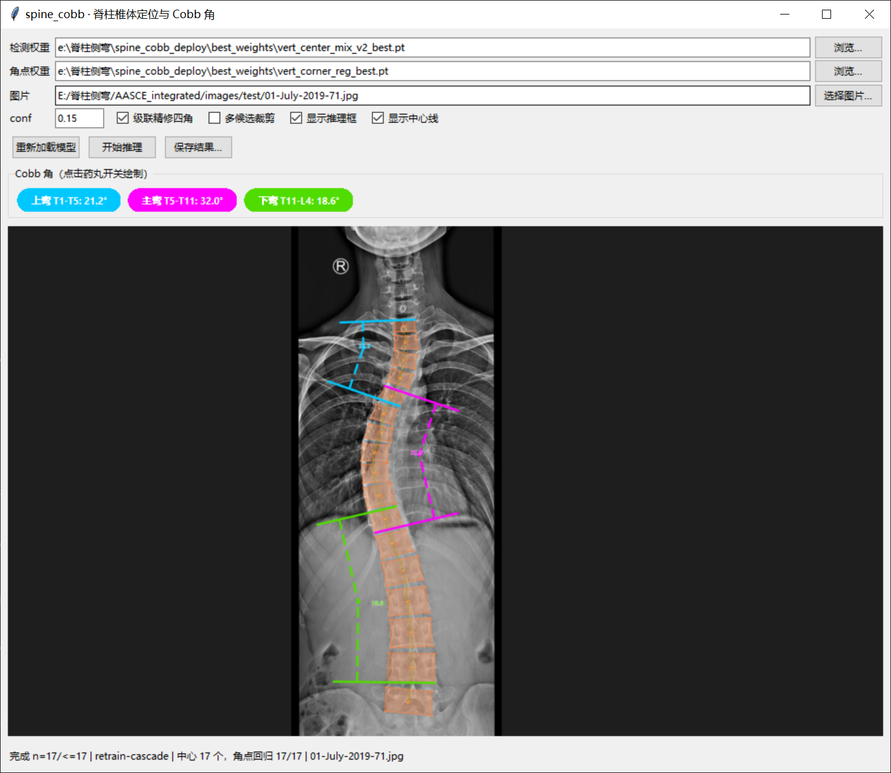
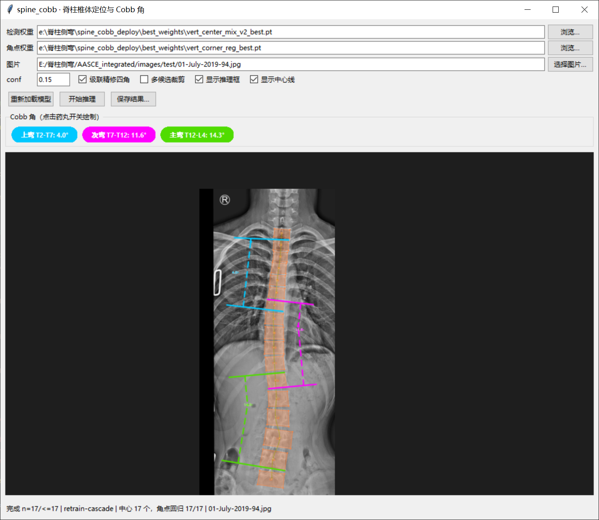

# spine_cobb

脊柱侧弯 X 光片椎体定位与 Cobb 角估算：YOLO 检出椎体中心 + 局部 CNN 回归四角。

本目录为**推理部署精简包**（仅含运行 GUI/级联所需代码与两个默认权重）。示例叠加图如下。

> 研究/工程原型，**不作为临床诊断设备**。发布前请确认你对 AASCE / Spinal 等数据拥有合规使用权。





## 流水线

```text
X 光原图
  →（可选）xray_preprocess 预处理
  → Stage A: YOLO 中心检出（≤17，按 y 排序）  [vert_center_mix_v2]
  → Stage B: 邻椎上下文裁剪 + CNN 四角回归     [vert_corner_reg]
  → 轻量邻接缝合 + Cobb 曲线
```

默认推理入口：`gui_infer.py`（推荐）或 `spine_pose_yolo/infer_retrain_cascade.py`。

## 环境

- Windows / Linux，Python **3.10+**（本仓库在 3.11 验证）
- NVIDIA GPU + CUDA 强烈推荐（CPU 可跑但很慢）
- 依赖见 `[requirements.txt](requirements.txt)`

```bash
# Conda 示例
conda create -n spine_cobb python=3.11 -y
conda activate spine_cobb

# 按本机 CUDA 安装 PyTorch：https://pytorch.org
# 例如 CUDA 12.x：
pip install torch torchvision --index-url https://download.pytorch.org/whl/cu124

pip install -r requirements.txt
```

GUI 需要系统自带 Tk（Windows 一般可用；Linux 需 `python3-tk`）。

## 权重部署

仓库默认**不提交**大权重与数据集。克隆后请把权重放到：

```text
best_weights/
  vert_center_mix_v2_best.pt   # 中心（必需）
  vert_corner_reg_best.pt      # 四角回归（必需，当前默认）
  spine_roi_best.pt            # 可选：多候选 ROI
```

也可把训练产物直接放在：

```text
spine_pose_yolo/runs/vert_center_mix_v2/weights/best.pt
spine_pose_yolo/runs/vert_corner_reg/best.pt
```

`gui_infer.py` 会按上述路径自动回退查找。

### 1. GUI（单张）

```bash
cd spine_cobb
python gui_infer.py
```

1. 确认「检测权重」= `best_weights/vert_center_mix_v2_best.pt`
2. 确认「精修权重」= `best_weights/vert_corner_reg_best.pt`
3. 勾选级联 →「加载模型」→ 选图 →「开始推理」


### 2. 命令行批量

```bash
python spine_pose_yolo/infer_retrain_cascade.py ^
  --center-weights best_weights/vert_center_mix_v2_best.pt ^
  --corner-weights best_weights/vert_corner_reg_best.pt ^
  --image-dir path/to/xrays ^
  --out-dir spine_pose_yolo/runs/infer_export ^
  --limit 20
```

Linux / macOS 将 `^` 换成 `\`。

输出为叠加椎体四角与 Cobb 的 PNG。

### 3. 整图级联指标（需 AASCE GT）

```bash
python spine_pose_yolo/eval_cascade_e2e.py ^
  --center-weights best_weights/vert_center_mix_v2_best.pt ^
  --corner-weights best_weights/vert_corner_reg_best.pt ^
  --aasce-dir path/to/AASCE_integrated/images/train ^
  --suitable-list path/to/AASCE_integrated/lists/train_suitable.txt ^
  --limit 40
```

## 目录结构

```text
spine_cobb/
├── gui_infer.py                 # GUI 推理入口
├── cobb_angles.py               # Cobb 曲线
├── xray_preprocess.py           # X 光预处理
├── robust_spine_infer.py        # 多候选裁剪（可选）
├── best_weights/                # 部署权重（需自行放入）
├── requirements.txt
├── spine_pose_yolo/
│   ├── infer_retrain_cascade.py # 级联推理 CLI
│   ├── corner_regressor.py      # 四角 CNN
│   ├── train_corner_regressor.py
│   ├── prepare_corner_reg_dataset.py
│   ├── prepare_retrain_datasets.py
│   ├── train_retrain.py         # 中心 YOLO 训练
│   ├── eval_cascade_e2e.py
│   ├── datasets/                # 本地生成，不入库
│   └── runs/                    # 训练/推理产物，不入库
└── spine_roi_yolo/              # 可选 ROI 检测
```

## 从零训练（可选）

数据需自备：

- **Spinal-AI2024**：中心点监督（构建 `vert_center_mix_v2`）
- **AASCE**：每图旁 `_corner.pts`（68 点）用于角点 / e2e

将路径改到本机后：

```bash
# 1) 中心数据 + 训练（示例）
python spine_pose_yolo/prepare_retrain_datasets.py --skip-patch --skip-ctx-patch --build-center-mix
python spine_pose_yolo/train_retrain.py --task center_mix

# 2) 四角回归数据 + 训练
python spine_pose_yolo/prepare_corner_reg_dataset.py ^
  --aasce-dir path/to/AASCE_integrated/images/train ^
  --suitable-list path/to/AASCE_integrated/lists/train_suitable.txt ^
  --center-weights best_weights/vert_center_mix_v2_best.pt

python spine_pose_yolo/train_corner_regressor.py --epochs 40 --batch 128 --device 0

# 权重会复制到 best_weights/vert_corner_reg_best.pt
```

历史 YOLO-Pose 角点实验（`vert_corner_ctx*` / `ctx_adj`）已不作为默认路径；仅作对照保留。

## 常见问题


| 现象          | 处理                                                     |
| ----------- | ------------------------------------------------------ |
| GUI「找不到权重」  | 检查 `best_weights/` 文件名是否与上文一致                          |
| 加载精修权重报错    | 确认是 `vert_corner_reg_best.pt`（CNN），不是旧 YOLO pose 误当回归器 |
| 中心缺检 / 只有几节 | 降低 conf；确认全身 AP 片、预处理未裁掉脊柱                             |
| CUDA OOM    | 推理一般很轻；训练可减小 `--batch`                                 |
| Linux 无 GUI | 使用 `infer_retrain_cascade.py` 命令行                      |


## 数据集来源、引用与致谢

本项目**不附带**训练/评测原始数据。模型训练与指标评估依赖以下公开数据集，请自行按原协议申请或下载，并遵守各自使用条款；**不得默认随本仓库公开分发**。

### AASCE2019（角点 / Cobb / e2e）

- **用途**：椎体四角（T1–L5，每椎 4 点共 68 点）监督、Cobb 估算与整图级联评测。
- **来源**：MICCAI 2019 Challenge — *Accurate Automated Spinal Curvature Estimation*（AASCE）。训练数据见 [SpineWeb Dataset 16](http://spineweb.digitalimaginggroup.ca/)，挑战主页：[aasce19.github.io](https://aasce19.github.io/) / [Grand Challenge](https://aasce19.grand-challenge.org/)。
- **说明**：约 707 张脊柱前后位（AP）X 光（训练 609 / 测试 98），由加拿大 London Health Sciences Center 采集；本仓库脚本中的 `AASCE_integrated` 为本地整理后的目录名。

若使用本数据或基于其训练的结果发表，请按挑战方要求引用相关工作，例如：

```text
Wang, L., et al. Evaluation and comparison of accurate automated spinal curvature
estimation algorithms with spinal anterior-posterior X-Ray images: The AASCE2019
challenge. Medical Image Analysis, 72, 102115, 2021.
https://doi.org/10.1016/j.media.2021.102115

Wu, H., Bailey, C., Rasoulinejad, P., & Li, S. Automatic landmark estimation for
adolescent idiopathic scoliosis assessment using BoostNet. MICCAI, 2017.
```

（挑战站点还建议一并引用 Wang et al. 2019 Multi-View Extrapolation Net、Chen et al. 2019 Spine Curve Analysis、Wu et al. 2018 MVC-Net 等；以官方 Paper 页为准。）

### Spinal-AI2024（中心点 / 混训）

- **用途**：椎体中心检出监督，以及与 AASCE suitable 混合构建 `vert_center_mix_v2` 等。
- **来源**：CurvNet 论文配套发布的生成式脊柱侧弯 X 光数据集（约 2 万张；建议 subset1–4 训练、subset5 测试）。
- **下载**：[github.com/Ernestchenchen/Spinal-AI2024](https://github.com/Ernestchenchen/Spinal-AI2024)

引用示例：

```text
Shao, Z., Yuan, Y., Ma, L., & Zhu, X. CurvNet: Latent Contour Representation and
Iterative Data Engine for Curvature Angle Estimation. Pattern Recognition, 2025.
https://doi.org/10.1016/j.patcog.2025.112546
```


### 致谢

感谢 AASCE2019 挑战组织者与标注医生、SpineWeb / Digital Imaging Group 提供脊柱影像与关键基准；感谢 CurvNet / Spinal-AI2024 作者开源大规模脊柱 X 光数据与标注。本仓库仅为研究/工程原型，**不作为临床诊断设备**。

## License / 数据

本仓库代码采用 [MIT License](LICENSE)。

- **第三方依赖**（如 [Ultralytics YOLO](https://github.com/ultralytics/ultralytics)）保留各自原许可；分发或商用时请一并遵守。
- **第三方数据**（AASCE、Spinal-AI2024 等）遵循其原始协议，**不得默认随本仓库公开分发**。
- 本软件按「现状」提供，**不作为临床诊断设备**，作者不对使用后果承担责任。


## 联系作者

邮箱： [3274609336@qq.com](mailto:3274609336@qq.com)